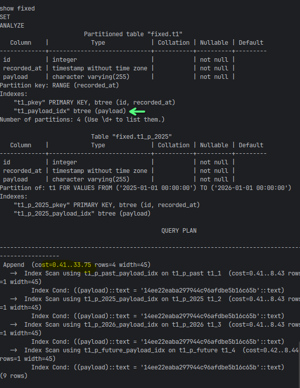
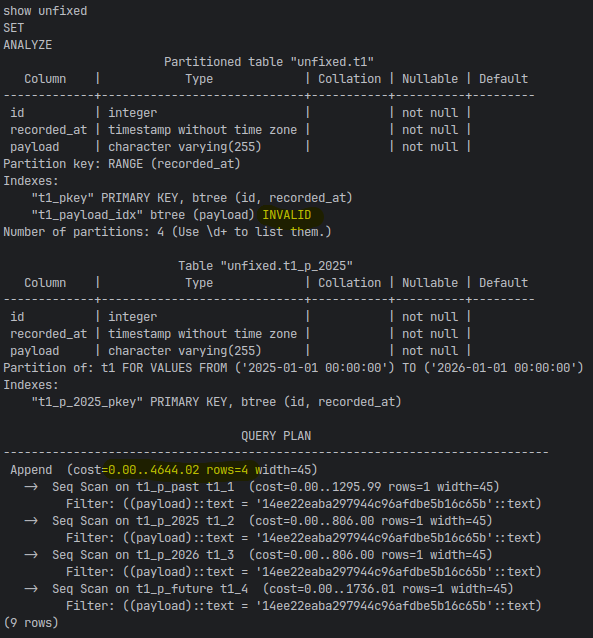

**Description**

At finalization step of `init_replica` indexes are recreated with `ON ONLY` option, when `keep_existing_schema` is on. This option creates them only on parent table, but not on partitions.

My investigation and hypothesis why I suppose it is a bug:

For an index on a partitioned table, pg_indexes.indexdef (built by pg_get_indexdef()) always returns CREATE INDEX … ON ONLY parent …. That format suits pg_dump, which creates each partition’s index separately and then runs ALTER INDEX … ATTACH PARTITION. pg_chameleon just replays the text without those steps. And because dropping the parent index also drops the partitions’ indexes, you end up with an invalid parent-only index and no indexes on any partition.

Git history. The logic was added in b923d66 and 8fe9823 (July 2020) and extended in 3427aa0 (2021), all by Federico Campoli. None of these commits mentions partitions, and nothing in the log refers to ONLY for indexes. Primary keys and unique keys use ALTER TABLE … ADD CONSTRAINT without ONLY, so they do reach the partitions. Only plain indexes are affected.

**The Fix**

The demo bench, reproducing the bug and testing the fix:
https://github.com/bondden/pg_chameleon-on-only-fix-demo

The fix:
https://github.com/bondden/pg_chameleon/commit/f8def070909564ba01df38b1c154912f65b1affa

**Steps To Reproduce**

1. create a partitioned table in MySQL.
2. create the target schema in PostgreSQL
3. set `keep_existing_schema` to yes
4. `init_replica`

**Expected Behavior**

Queries against partitioned tables are as fast, as in MySQL, partitions are covered with indexes.

**Actual Behavior**

Queries are two orders of magnitude slower. pPrent table is covered with indexes, but partitions - are not. So index is not used in query plan.

**Environment(please complete the following information):**

- pg_chameleon v2.0.21
- OS: Ubuntu 22.04.3
- MySQL 8.0.28
- PostgreSQL 17.6
- Python 3.11

